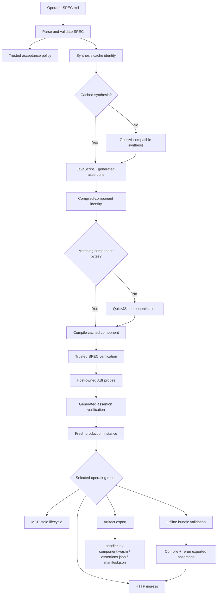

# nosrc architecture

## Status and scope

nosrc is an experimental, single-process Rust application runtime. It transforms an operator-authored `SPEC.md` into a self-contained JavaScript handler, componentizes that handler for QuickJS/WebAssembly, verifies it, and makes it available through four operating modes:

1. **HTTP runtime** — verifies and activates a handler during startup, then serves HTTP requests.
2. **MCP control plane** — exposes lifecycle and invocation tools over local stdio, either standalone or alongside an optional HTTP listener in the same process.
3. **Artifact export** — runs the synthesis and verification pipeline, then writes source, component, assertions, and manifest files for review and version control.
4. **Offline bundle serving** — loads an exported component, checks its digest and manifest metadata, reruns both exported assertion suites and the fixed host-owned ABI probes, and starts HTTP ingress without an LLM/provider dependency.

These are workflows around the same handler contract and engine, not separate guest runtimes. Standalone MCP has no HTTP listener. In shared mode, the MCP server and HTTP ingress hold the same `AppLifecycle`-owned `IngressState`; activation and rollback atomically publish the selected handler to HTTP. No cross-process synchronization is implied.

The project is not production-ready. Security review, broader adversarial testing, persistence, and operational hardening remain future work.

## High-level data flow



The diagram shows the common preparation path. MCP direct-JavaScript preparation starts from supplied source rather than LLM synthesis, but still applies the operator-owned trusted SPEC verification policy before a candidate can be activated. When `mcp --http-port` is enabled, the MCP and HTTP interfaces share that same lifecycle; without it, MCP remains stdio-only.

## Startup and preparation lifecycle

The HTTP and export CLI paths:

1. Read and parse the selected SPEC.
2. Validate runtime-supported capabilities and the human-authored verification suite.
3. Derive a versioned synthesis SHA-256 identity from the raw SPEC, configured provider URL/model/temperature, and synthesis prompt/schema. Compilation dependencies and `Cargo.lock` are excluded from this identity.
4. Load the synthesis entry by that identity or request JavaScript and supplemental assertions from the configured OpenAI-compatible endpoint. The model prompt excludes the operator's `## Verification` section; optional `## Examples` content is illustrative only.
5. Derive a separate compiled-component identity from the complete synthesis-output digest plus `Cargo.toml` feature selection, `Cargo.lock`, package/toolchain versions, WIT/ABI, componentizer settings, and the fuel/memory settings that affect execution. Reuse component bytes only when this identity matches; otherwise componentize the cached JavaScript again without another model request.
6. Run trusted SPEC assertions against an isolated candidate instance.
7. Run fixed host-generated adversarial ABI probes against a separate disposable candidate instance.
8. Run generated supplemental assertions against another isolated candidate instance.
9. Reject preparation if the trusted suite, host probes, or generated suite fails.
10. Instantiate a fresh production handler only after all required checks pass.
11. Store newly generated verified artifacts in the local cache when caching is enabled.

The export command then writes the exported files and exits without starting HTTP ingress. The HTTP command starts its listener only after successful preparation. The `serve --bundle` command instead loads the exported component and assertion suites, verifies integrity metadata, reruns both suites on isolated candidates, runs host-owned ABI probes on another disposable candidate, and opens HTTP ingress only after every check passes. It does not load a SPEC, instantiate the synthesizer, or read LLM credentials.

MCP `source: "spec"` uses the same mandatory trusted suite, host-owned ABI probes, and generated suite. MCP `source: "draft_spec"` synthesizes from an agent-supplied contract while retaining the startup acceptance policy. Its SPEC verification cases are candidate checks, not trusted policy. In MCP-first mode, draft/model assertions and baseline runtime limits allow draft-SPEC preparation and export for review, but activation is rejected because no operator-controlled acceptance policy exists. `MCP source: "direct_js"` can be compiled/prepared as a check, but without a startup SPEC it cannot be invoked, activated, or exported. Every activation requires a non-empty operator-controlled SPEC verification suite loaded at process startup. An operator reviews the exported draft, restarts with it as `--spec`, and prepares a candidate against that immutable policy. Optional client-supplied assertions remain informational and cannot relax trusted policy. In shared HTTP mode, only explicit activation or rollback changes the handler visible to HTTP.

## Core contracts and components

### SPEC and acceptance policy

The operator controls the optional SPEC loaded at process startup. In operator-controlled mode, it declares endpoints, supported capability requirements, and human-authored verification cases; every declared endpoint must be covered by at least one trusted case. In MCP-first mode no application-specific trusted policy exists initially, but baseline fuel, memory, response, and input limits remain enforced. An agent-provided draft SPEC is used only as synthesis input and does not modify the startup acceptance policy. Verification cases in a draft must be structurally valid and cover its declared endpoints, but they are not promoted to operator trust.

The current runtime accepts only `state: volatile`, no outbound egress declarations, and no database schema declarations. Other state/capability declarations are rejected rather than silently ignored.

### Synthesis

The synthesizer calls an OpenAI-compatible chat-completions endpoint. `LLM_API_KEY` is required when a request is made (HTTP and export check it lazily, so a cache hit needs no key); `LLM_BASE_URL` (https, or loopback http) and `LLM_MODEL` are optional. `LlmConfig` redacts the key in `Debug`, provider error bodies are scrubbed before reporting, and transient failures (429, 5xx, connect, timeout) are retried with backoff. The model receives the SPEC with the operator-controlled `## Verification` section removed. A `## Examples` section remains visible as explanatory input only; it is not acceptance policy. The expected output contains JavaScript handler source, a code-format identifier, generated assertions, and optional rationale.

Generated code is untrusted input. It must satisfy the expected schema, componentize successfully, and pass the required verification suites before activation.

When a synthesized candidate has an invalid artifact shape, fails componentization, or fails trusted/generated verification, preparation may request at most two additional candidates. Repair feedback is host-authored and limited to a failure category, suite category, and failed-check count; it never includes operator assertion names, request inputs, expected values, response bodies, or assertion definitions. Each replacement candidate starts the complete componentization and verification path again. The operator suite and host-owned ABI probes remain unchanged and mandatory. Provider transport retries are a separate mechanism; provider/transport failures do not consume or trigger candidate-repair attempts.

### Componentization and execution

`src/engine/quickjs.rs` uses `componentize-qjs` to compile a self-contained ES module against the fixed WIT world:

```wit
package nosrc:runtime@2.0.0;

interface http {
    record header { name: string, value: list<u8> }
    record request { method: string, scheme: option<string>, authority: option<string>, path: string, query: option<string>, headers: list<header>, body: list<u8>, body-text: option<string> }
    variant response-body { text(string), bytes(list<u8>) }
    record response { status: u16, headers: list<header>, body: response-body }
}

world handler {
    use http.{request, response};
    export handle: func(request: request) -> response;
}
```

The handler contract is typed WIT: `handle(request) -> response`. Request bodies expose authoritative raw bytes plus an optional host-validated UTF-8 text view (`null` for invalid UTF-8); header values remain raw bytes. Response bodies are explicitly `text(string)` (host UTF-8 encoding) or `bytes(list<u8>)`. Repeated header occurrences are retained. The component runs with Wasmtime 50. WASI imports are stubbed; the guest receives no filesystem, process, network, SQL, or KV host imports.

Each component store defaults to a 250,000,000-unit fuel budget and a 64 MiB per-linear-memory growth limit. Operators may lower these per-process budgets with `NOSRC_MAX_FUEL` and `NOSRC_MAX_MEMORY_BYTES`; the immutable ceilings remain 250,000,000 and 64 MiB. The complete guest response envelope defaults to 1 MiB and may be lowered with `NOSRC_MAX_RESPONSE_BYTES`, never raised. Zero, malformed, and over-ceiling values fail startup with an actionable configuration error. The 1 MiB HTTP request-body ceiling, 30-second guest epoch deadline, and 5-second component startup deadline remain fixed in v0.1. The fuel ceiling was raised from 50,000,000 after the ABI v2 1 MiB JSON benchmark measured approximately 143–178 million units for request handling and response serialization; the independent 30-second epoch deadline remains the wall-clock execution bound. Table elements, instances, tables, memories, and component handles are also bounded. The response envelope is capped at 1 MiB. Fuel is reset before each invocation. The runtime records fuel consumed by the most recent invocation and the largest per-invocation consumption observed by the generation; values are absent when Wasmtime cannot report them. The resource limiter records accepted linear-memory growth targets, rolling back a target when Wasmtime reports that allocation failed. The current-instance memory high-water resets when a trapped instance is replaced, while the generation high-water retains the maximum observed across replacements. These are guest linear-memory measurements, not total process or Wasmtime host memory. Wasmtime epoch interruption is enabled independently of fuel: a process-local ticker advances each engine epoch every 10 ms, and each guest invocation sets its own deadline (30 seconds by default). Epoch interruption is coarse-grained; a deadline is observed at the next instrumented guest check and is not an exact real-time cutoff. Startup and recovery instantiation also have a bounded epoch deadline. A guest trap, including an epoch timeout, discards the trapped instance and attempts recreation from the compiled component. Each successful replacement increments the generation-scoped `instance_recreations` counter and emits a warning with a bounded failure category; guest-controlled exception and trap text is neither returned to HTTP clients nor written to request-failure logs. If recovery fails, that handler is marked unusable rather than reusing the trapped store.

### Host process failure policy

Release builds use Rust's `panic = "abort"` policy. A panic in host code terminates the entire nosrc process; it is not converted into a request error and is not recovered with broad `catch_unwind` handling. Run release deployments under an external process supervisor (for example, systemd, a container orchestrator, or another service manager) configured to restart the process after an unexpected exit. Guest Wasm traps are a separate failure class and remain contained to the current invocation through instance replacement.

JavaScript module-level variables are the only current guest state. They survive successful requests to the same handler instance. Calls to one instance are serialized to preserve deterministic state behavior.

### Verification

Trusted SPEC cases, host-generated ABI probes, and generated supplemental assertions each run on separate disposable candidate instances. Each assertion suite runs sequentially on one instance so stateful request sequences within that suite are preserved. The production instance is created separately after required checks pass.

The trusted verifier checks operator-configured response status, response-body substring, and response-header expectations. Trusted cases can set request headers, a UTF-8 request body (`Request body:` in SPEC.md), and raw encoded query text. SPEC grammar remains scalar and rejects repeated query keys; the runtime ABI itself preserves raw query encoding and repeated headers. Verification failures are logged with a one-based case number and expected/actual status; request bodies and assertion contents are not logged.

Host probes are fixed by the runtime and are not derived from SPEC text or model output. They exercise a minimal request, an encoded path with unusual query/header values, and a JSON body containing escaped delimiters and Unicode. They require the guest not to trap and to return a bounded, syntactically valid response envelope with a valid HTTP status and header syntax. They do not test application-specific route semantics, authorization, data handling, or general security.

Generated assertions are supplemental regression checks. Passing trusted assertions and host probes is not proof of correctness, absence of vulnerabilities, or semantic equivalence to the SPEC.

### Artifact cache

The local content-addressed cache defaults to `.nosrc-cache/` and uses two versioned identities. The synthesis identity covers raw SPEC input, provider URL/model/temperature, and the prompt/schema; it excludes `Cargo.lock` and compilation-only dependencies. The compiled-component identity covers the complete synthesis-output digest plus `Cargo.toml` feature selection, `Cargo.lock`, package/toolchain versions, WIT/ABI, componentizer settings, and relevant resource limits. A lockfile-only change therefore reuses cached JavaScript/assertions and rebuilds only the component. Cache manifests bind both identities and the synthesis/component content digests; legacy or incompatible manifest schemas are safe cache misses. Cache files are written through temporary files and atomically published individually; the manifest is written last as the entry commit marker.

A matching component hit can avoid componentization, but it never bypasses compilation with the current Wasmtime engine or either verification suite. A synthesis hit with a different component identity reuses the source and assertions, recompiles the component, and stores the new verified component identity. The cache is an operator-managed optimization, not a trust boundary. Keep it writable only by the service operator. Use `--no-cache` to bypass cache reads and writes or `--cache-dir` to select another location.

### HTTP ingress

Axum handles `GET /healthz`, `GET /readyz`, and `GET /_nosrc/status`. `/healthz` is a liveness probe and returns 200 while the listener responds. `/readyz` returns 200 only after the listener has bound successfully and an active verified generation exists; it returns 503 before listener readiness, with no active generation, and after listener shutdown. In MCP shared-HTTP mode, the listener can be ready while MCP-first application state is still empty, so readiness remains 503 until activation. `/_nosrc/status` reports a matching `ready` boolean alongside active-generation and telemetry fields. These probes bypass application admission. The status response includes a versioned `telemetry` object for the active generation with last-invocation fuel, generation fuel high-water, current-instance memory high-water, generation memory high-water, and the number of successfully recreated guest instances after traps. The recreation count is generation-scoped and survives instance replacement; the current-instance memory high-water resets with the replacement while the generation memory high-water is retained. Measurements are numeric or null when unavailable and never include request or guest payload data. Other requests are converted into the handler request envelope and dispatched to the active QuickJS handler. The listener binds to `127.0.0.1` by default; external binding requires an explicit `--bind` address. The accept loop enforces a 128-connection ceiling before spawning per-connection tasks; when the cap is reached, newly accepted sockets are closed. Transient accept failures (interrupted, aborted, would-block, and descriptor-exhaustion errors) are logged and retried with a short backoff; non-transient listener failures terminate the server. On SIGINT, or on Unix SIGTERM, the listener stops accepting and active connection tasks are drained for up to 30 seconds by default, then remaining tasks are aborted. Set `--shutdown-timeout SECONDS` or `NOSRC_SHUTDOWN_TIMEOUT_SECS` to change the deadline. This transport-level bound is independent of application request admission.

Incoming HTTP request bodies are limited to 1 MiB. The complete serialized guest response envelope—including body bytes, headers, and WIT framing overhead—is limited to 1 MiB. ABI v2 preserves arbitrary request bytes, exposes an optional host-validated UTF-8 request-text view, and preserves byte-valued/repeated header fields. Guest response bodies explicitly select UTF-8 text or raw bytes. The host owns message framing, strips guest framing/hop-by-hop fields, and suppresses content for HEAD, 204, 205, and 304. A mutex serializes calls to the active handler instance, and the execution permit remains owned by the blocking guest task until it exits—even if the client disconnects. Epoch interruption ensures an untrusted infinite guest loop eventually traps and releases that permit. HTTP error responses use sanitized messages while detailed diagnostics are written to server logs.

### MCP control plane

`nosrc mcp --spec ./SPEC.md` starts a local MCP server over stdio and does not start an HTTP listener. The six tools are:

- `prepare_app` — prepare a candidate from the operator SPEC or direct JavaScript; does not activate it. Successful results include the versioned resource telemetry snapshot. Failures return structured diagnostics with deterministic suite-scoped case IDs, expected/actual status, a small allowlist of response headers, redacted JSON-only body previews, compiler diagnostics, and fuel/memory/deadline categories. Trusted case names, request inputs, expected body/header values, and arbitrary non-JSON response bodies are not returned.
- `activate_app` — activate a retained ready generation.
- `invoke_app` — invoke the active generation through the QuickJS handler.
- `get_app_status` — inspect active, previous, and retained generations, verification summaries, and effective resource limits.
- `rollback_app` — reactivate the immediately previous retained generation.
- `export_app` — publish a prepared generation through the existing atomic artifact exporter for offline serving. The destination is a single directory name beneath the operator-configured export root; traversal and absolute paths are rejected.

The stdio process has no MCP-level authentication or authorization. Trust is inherited from the local launcher and ownership of its stdin/stdout pipes. Protocol messages use stdout; diagnostics are sent to stderr. In shared-HTTP mode, the HTTP task and stdio service are supervised together: an HTTP shutdown signal drains HTTP connections and then ends the MCP process; if the MCP client disconnects first, the HTTP task is stopped.

Preparation snapshots immutable engine, SPEC, cache, and policy inputs while briefly holding the lifecycle mutex. LLM requests, componentization, and candidate verification happen outside that lock. Componentization and Wasm verification run on Tokio's blocking pool. The lock is reacquired to publish a fully prepared generation. A timed-out caller cannot publish a candidate later, although an already-running blocking task may finish in the background.

Generation identifiers, prepared/active generations, and rollback history are process-local. Restarting the MCP process discards them. A separately running HTTP process has its own independent active handler and state.

## Exported artifacts

`nosrc export --spec ./SPEC.md --out-dir ./dist` runs the verified preparation pipeline and writes:

- `handler.js` — synthesized JavaScript handler source.
- `component.wasm` — compiled WebAssembly component bytes.
- `assertions.json` — trusted and generated assertion suites.
- `SPEC.md` — exact SPEC text used for synthesis.
- `manifest.json` — service name, SPEC digest, module/component digests, assertion counts, synthesis rationale, and whether assertions are operator-policy or draft-policy.

The export manifest is provenance metadata. It does not contain a signed attestation, explicit per-assertion result records, toolchain identity, effective resource policy, or a cryptographic signature. Export writes all files into a temporary sibling directory and publishes the completed bundle with one same-filesystem directory rename. The destination must not already exist; export refuses replacement rather than performing a non-atomic directory swap. See `docs/ARTIFACTS.md`.

## Configuration and operational limits

- Rust 1.97 or later is required.
- `LLM_API_KEY` is required when synthesis is needed; HTTP and export defer the check until a model request would be sent.
- `LLM_BASE_URL` defaults to `https://api.openai.com/v1`.
- `LLM_MODEL` defaults to `gpt-4o-mini`.
- LLM requests are limited to 2 MiB serialized request size, with a 10-second connect timeout and 120-second total timeout. Success and error response bodies are capped at 4 MiB and 8 KiB.
- HTTP request bodies and guest response envelopes are capped at 1 MiB. Synthesized JavaScript handlers are capped at 2 MiB across CLI and MCP preparation.
- Verbose diagnostics are enabled with `--verbose`; `RUST_LOG` overrides the scoped default.
- The MCP lifecycle has a preparation timeout. Cancellation prevents publication after timeout but does not guarantee termination of an already-running blocking worker.

See `docs/CLI.md` for command options and `docs/SECURITY.md` for trust boundaries and open risks.

## State and persistence roadmap

**Current behavior:** application state exists only in JavaScript module memory within one active generation. It is lost on handler replacement and process restart. MCP generation metadata and rollback history are also process-local. The artifact cache and exported files are disk artifacts, not guest application-state persistence.

**Backlog:** persistence remains a planned capability. It is deferred, not permanently out of scope. Future work must design and test at least two distinct concerns:

1. **Application-state persistence:** a guest-visible, narrowly scoped WIT contract (initially bounded embedded KV is a candidate) with explicit capability policy, key/value and operation limits, candidate isolation, consistency semantics, and recovery behavior.
2. **Control-plane persistence:** durable generation metadata and rollback/recovery semantics across process restarts, including how artifacts are associated with verified generations.

These concerns must not be conflated. The persistence design must preserve fail-closed verification, tenant/application isolation if multi-app support is introduced, and clear behavior when storage is unavailable. No current CLI or MCP mode provides these guarantees.

## Implemented test coverage

The repository includes tests for:

- JavaScript componentization and handler execution.
- Module state across multiple calls.
- Invalid JavaScript rejection.
- Fuel exhaustion and recovery after a guest trap.
- Component memory and response-size limits.
- SPEC verification parsing, endpoint coverage, documented response statuses, and duplicate-field rejection.
- Separate trusted and generated verification instances.
- Candidate acceptance/rejection and stateful assertion sequences.
- HTTP ingress dispatch, health/status routes, and no-active-generation behavior.
- Artifact cache round trips, digest/metadata validation, malformed entries, and atomic file publication.
- Export of the handler, component, assertions, and manifest.
- MCP tool registration, generation lifecycle, policy enforcement, timeout cancellation, and stdio protocol behavior.

The test list is representative rather than an exhaustive inventory; tests in source modules remain authoritative.

## Backlog and non-goals

Planned or deferred areas include durable application-state persistence, durable generation/control-plane metadata, stronger artifact attestations and provenance, broader security testing, safe generation replacement with in-flight request draining, remote MCP transport and authentication, multi-application isolation, and production deployment/orchestration.

Autonomous self-healing, automatic regeneration from production failures, automatic file watching/rebuild, and automatic rollback are not implemented. Do not describe these as existing features.

## Security requirements before production use

- Guest code must not receive ambient filesystem, process, or network access.
- Every future host capability must be declared in WIT, granted explicitly, bounded, and tested for disabled-by-default behavior.
- Any future outbound HTTP capability must validate DNS answers and every redirect target, including IPv4/IPv6 private, loopback, link-local, and metadata ranges.
- Database operations need query, row-count, result-size, and execution-time bounds before exposure.
- Request and response sizes must remain bounded; ABI v2 already defines raw-byte request and response bodies.
- Candidate verification must use isolated state and must not leak temporary artifacts.
- Resource limits must be tested against the actual QuickJS component runtime.
- LLM output is untrusted input and must be schema-validated, componentized, and verified before activation.


## Release versioning

The project publishes milestone releases using two-component Git tags and GitHub Release names: `v0.1`, `v0.2`, and so on. The Cargo package version remains a valid three-component SemVer value (for example, `0.1.0`) because Cargo requires that format. The package major/minor components must match the release tag. Patch-level tags and releases such as `v0.1.1` or `v0.1.0` are invalid for this project. The release workflow validates this mapping before creating a GitHub Release. See `docs/RELEASING.md`.
