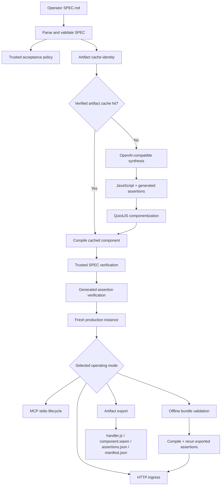

# nosrc architecture

## Status and scope

nosrc is an experimental, single-process Rust application runtime. It transforms an operator-authored `SPEC.md` into a self-contained JavaScript handler, componentizes that handler for QuickJS/WebAssembly, verifies it, and makes it available through four operating modes:

1. **HTTP runtime** — verifies and activates a handler during startup, then serves HTTP requests.
2. **MCP control plane** — exposes lifecycle and invocation tools over local stdio, either standalone or alongside an optional HTTP listener in the same process.
3. **Artifact export** — runs the synthesis and verification pipeline, then writes source, component, assertions, and manifest files for review and version control.
4. **Offline bundle serving** — loads an exported component, checks its digest and manifest metadata, reruns both exported assertion suites, and starts HTTP ingress without an LLM/provider dependency.

These are workflows around the same handler contract and engine, not separate guest runtimes. Standalone MCP has no HTTP listener. In shared mode, the MCP server and HTTP ingress hold the same `AppLifecycle`-owned `IngressState`; activation and rollback atomically publish the selected handler to HTTP. No cross-process synchronization is implied.

The project is not production-ready. Security review, broader adversarial testing, persistence, and operational hardening remain future work.

## High-level data flow



The diagram shows the common preparation path. MCP direct-JavaScript preparation starts from supplied source rather than LLM synthesis, but still applies the operator-owned trusted SPEC verification policy before a candidate can be activated. When `mcp --http-port` is enabled, the MCP and HTTP interfaces share that same lifecycle; without it, MCP remains stdio-only.

## Startup and preparation lifecycle

The HTTP and export CLI paths:

1. Read and parse the selected SPEC.
2. Validate runtime-supported capabilities and the human-authored verification suite.
3. Derive a SHA-256 cache identity from the raw SPEC, configured provider URL/model, synthesis prompt, WIT contract, QuickJS fuel and linear-memory limits, componentizer/runtime configuration flags, package version, and `Cargo.lock`. Other execution limits that do not affect artifact generation are not separately represented in the key.
4. Load a matching local cache entry or request JavaScript and supplemental assertions from the configured OpenAI-compatible endpoint.
5. Componentize JavaScript when synthesis was required; compile the component with the current Wasmtime component engine even on a cache hit.
6. Run trusted SPEC assertions against an isolated candidate instance.
7. Run generated supplemental assertions against a different isolated candidate instance.
8. Reject preparation if either mandatory suite fails.
9. Instantiate a fresh production handler only after successful verification.
10. Store newly generated verified artifacts in the local cache when caching is enabled.

The export command then writes the exported files and exits without starting HTTP ingress. The HTTP command starts its listener only after successful preparation. The `serve --bundle` command instead loads the exported component and assertion suites, verifies integrity metadata, reruns both suites on isolated candidates, and opens HTTP ingress only after successful verification. It does not load a SPEC, instantiate the synthesizer, or read LLM credentials.

MCP `source: "spec"` uses the same mandatory trusted and generated suites. MCP `source: "draft_spec"` synthesizes from an agent-supplied contract while retaining the startup acceptance policy. Its SPEC verification cases are added to the candidate assertion suite, not promoted to trusted policy; in MCP-first mode this means draft/model assertion verification plus baseline runtime limits, not operator-authored trusted assertions. MCP `source: "direct_js"` skips LLM synthesis and has no model-generated suite, but must still pass every trusted SPEC assertion. Optional client-supplied assertions in direct-JavaScript mode are informational and cannot relax the trusted policy. In shared HTTP mode, only an explicit `activate_app` or `rollback_app` changes the handler visible to HTTP; preparing a candidate never publishes it.

## Core contracts and components

### SPEC and acceptance policy

The operator controls the optional SPEC loaded at process startup. In operator-controlled mode, it declares endpoints, supported capability requirements, and human-authored verification cases; every declared endpoint must be covered by at least one trusted case. In MCP-first mode no application-specific trusted policy exists initially, but baseline fuel, memory, response, and input limits remain enforced. An agent-provided draft SPEC is used only as synthesis input and does not modify the startup acceptance policy. Verification cases in a draft must be structurally valid and cover its declared endpoints, but they are not promoted to operator trust.

The current runtime accepts only `state: volatile`, no outbound egress declarations, and no database schema declarations. Other state/capability declarations are rejected rather than silently ignored.

### Synthesis

The synthesizer calls an OpenAI-compatible chat-completions endpoint. `LLM_API_KEY` is required for synthesis; `LLM_BASE_URL` and `LLM_MODEL` are optional. The expected output contains JavaScript handler source, a code-format identifier, generated assertions, and optional rationale.

Generated code is untrusted input. It must satisfy the expected schema, componentize successfully, and pass the required verification suites before activation.

### Componentization and execution

`src/engine/quickjs.rs` uses `componentize-qjs` to compile a self-contained ES module against the fixed WIT world:

```wit
package nosrc:runtime;

world handler {
    export handle: func(request: string) -> string;
}
```

The handler contract is `handle(requestJson: string) -> responseJson: string`. Request and response values are JSON strings following `src/engine/http_envelope.rs`. The component runs with Wasmtime 50. WASI imports are stubbed; the guest receives no filesystem, process, network, SQL, or KV host imports.

Each component store enforces a default fuel budget of 50,000,000 units and a 64 MiB per-linear-memory growth limit. Table elements, instances, tables, memories, and component handles are also bounded. The response envelope is capped at 1 MiB. Fuel is reset before each invocation. A guest trap causes the component instance to be recreated from the compiled component before the error is returned.

JavaScript module-level variables are the only current guest state. They survive successful requests to the same handler instance. Calls to one instance are serialized to preserve deterministic state behavior.

### Verification

Trusted SPEC cases and generated supplemental assertions run on separate disposable candidate instances. Each suite runs sequentially on one instance so stateful request sequences within that suite are preserved. The production instance is created separately after required suites pass.

The verifier checks configured response status, body substring, and response-header expectations. Trusted cases can also set request headers and decoded query parameters. The string-map request ABI cannot represent multi-valued query parameters; repeated query keys in trusted verification headings are rejected.

Passing assertions are acceptance checks against authored examples, not a proof of correctness, absence of vulnerabilities, or semantic equivalence to the SPEC.

### Artifact cache

The local content-addressed cache defaults to `.nosrc-cache/`. Its key incorporates inputs and toolchain settings that affect generated artifacts, excluding the API key. Cache entries include synthesis metadata and component bytes with SHA-256 digests. Cache files are written through temporary files and atomically published individually; the manifest is written last as the entry commit marker.

A cache hit can avoid an LLM request and componentization. It does not bypass component compilation with the current Wasmtime engine or either verification suite. The cache is an operator-managed optimization, not a trust boundary. Keep it writable only by the service operator. Use `--no-cache` to bypass cache reads and writes or `--cache-dir` to select another location.

### HTTP ingress

Axum handles `GET /healthz` and `GET /_nosrc/status`. Other requests are converted into the handler request envelope and dispatched to the active QuickJS handler. The listener binds to `127.0.0.1` by default; external binding requires an explicit `--bind` address.

Incoming HTTP request bodies and serialized guest response envelopes are limited to 1 MiB. The current text-based ABI does not support arbitrary non-UTF-8 request bodies. A mutex serializes calls to the active handler instance. HTTP error responses use sanitized messages while detailed diagnostics are written to server logs.

### MCP control plane

`nosrc mcp --spec ./SPEC.md` starts a local MCP server over stdio and does not start an HTTP listener. The six tools are:

- `prepare_app` — prepare a candidate from the operator SPEC or direct JavaScript; does not activate it.
- `activate_app` — activate a retained ready generation.
- `invoke_app` — invoke the active generation through the QuickJS handler.
- `get_app_status` — inspect active, previous, and retained generations, verification summaries, and effective resource limits.
- `rollback_app` — reactivate the immediately previous retained generation.
- `export_app` — publish a prepared generation through the existing atomic artifact exporter for offline serving.

The stdio process has no MCP-level authentication or authorization. Trust is inherited from the local launcher and ownership of its stdin/stdout pipes. Protocol messages use stdout; diagnostics are sent to stderr.

Preparation snapshots immutable engine, SPEC, cache, and policy inputs while briefly holding the lifecycle mutex. LLM requests, componentization, and candidate verification happen outside that lock. Componentization and Wasm verification run on Tokio's blocking pool. The lock is reacquired to publish a fully prepared generation. A timed-out caller cannot publish a candidate later, although an already-running blocking task may finish in the background.

Generation identifiers, prepared/active generations, and rollback history are process-local. Restarting the MCP process discards them. A separately running HTTP process has its own independent active handler and state.

## Exported artifacts

`nosrc export --spec ./SPEC.md --out-dir ./dist` runs the verified preparation pipeline and writes:

- `handler.js` — synthesized JavaScript handler source.
- `component.wasm` — compiled WebAssembly component bytes.
- `assertions.json` — trusted and generated assertion suites.
- `SPEC.md` — exact SPEC text used for synthesis.
- `manifest.json` — service name, SPEC digest, module/component digests, assertion counts, synthesis rationale, and whether assertions are operator-policy or draft-policy.

The export manifest is provenance metadata. It does not contain a signed attestation, explicit per-assertion result records, toolchain identity, effective resource policy, or a cryptographic signature. Export writes all files into a temporary sibling directory and publishes the completed bundle with one same-filesystem directory rename. The destination must not already exist; export refuses replacement rather than performing a non-atomic directory swap. See `docs/ARTIFACTS.md`.

## Configuration and operational limits

- Rust 1.97 or later is required.
- `LLM_API_KEY` is required when synthesis is needed.
- `LLM_BASE_URL` defaults to `https://api.openai.com/v1`.
- `LLM_MODEL` defaults to `gpt-4o-mini`.
- LLM requests are limited to 2 MiB serialized request size, with a 10-second connect timeout and 120-second total timeout. Success and error response bodies are capped at 4 MiB and 8 KiB.
- HTTP request bodies and guest response envelopes are capped at 1 MiB.
- Verbose diagnostics are enabled with `--verbose`; `RUST_LOG` overrides the scoped default.
- The MCP lifecycle has a preparation timeout. Cancellation prevents publication after timeout but does not guarantee termination of an already-running blocking worker.

See `docs/CLI.md` for command options and `docs/SECURITY.md` for trust boundaries and open risks.

## State and persistence roadmap

**Current behavior:** application state exists only in JavaScript module memory within one active generation. It is lost on handler replacement and process restart. MCP generation metadata and rollback history are also process-local. The artifact cache and exported files are disk artifacts, not guest application-state persistence.

**Backlog:** persistence remains a planned capability. It is deferred, not permanently out of scope. Future work must design and test at least two distinct concerns:

1. **Application-state persistence:** a guest-visible, narrowly scoped WIT contract (initially bounded embedded KV is a candidate) with explicit capability policy, key/value and operation limits, candidate isolation, consistency semantics, and recovery behavior.
2. **Control-plane persistence:** durable generation metadata and rollback/recovery semantics across process restarts, including how artifacts are associated with verified generations.

These concerns must not be conflated. The persistence design must preserve fail-closed verification, tenant/application isolation if multi-app support is introduced, and clear behavior when storage is unavailable. No current CLI or MCP mode provides these guarantees.

## Implemented test coverage

The repository includes tests for:

- JavaScript componentization and handler execution.
- Module state across multiple calls.
- Invalid JavaScript rejection.
- Fuel exhaustion and recovery after a guest trap.
- Component memory and response-size limits.
- SPEC verification parsing, endpoint coverage, documented response statuses, and duplicate-field rejection.
- Separate trusted and generated verification instances.
- Candidate acceptance/rejection and stateful assertion sequences.
- HTTP ingress dispatch, health/status routes, and no-active-generation behavior.
- Artifact cache round trips, digest/metadata validation, malformed entries, and atomic file publication.
- Export of the handler, component, assertions, and manifest.
- MCP tool registration, generation lifecycle, policy enforcement, timeout cancellation, and stdio protocol behavior.

The test list is representative rather than an exhaustive inventory; tests in source modules remain authoritative.

## Backlog and non-goals

Planned or deferred areas include durable application-state persistence, durable generation/control-plane metadata, a versioned binary request ABI, stronger artifact attestations and provenance, broader security testing, safe generation replacement with in-flight request draining, remote MCP transport and authentication, multi-application isolation, and production deployment/orchestration.

Autonomous self-healing, automatic regeneration from production failures, automatic file watching/rebuild, and automatic rollback are not implemented. Do not describe these as existing features.

## Security requirements before production use

- Guest code must not receive ambient filesystem, process, or network access.
- Every future host capability must be declared in WIT, granted explicitly, bounded, and tested for disabled-by-default behavior.
- Any future outbound HTTP capability must validate DNS answers and every redirect target, including IPv4/IPv6 private, loopback, link-local, and metadata ranges.
- Database operations need query, row-count, result-size, and execution-time bounds before exposure.
- Request and response sizes must remain bounded; binary bodies require an explicit ABI design.
- Candidate verification must use isolated state and must not leak temporary artifacts.
- Resource limits must be tested against the actual QuickJS component runtime.
- LLM output is untrusted input and must be schema-validated, componentized, and verified before activation.
